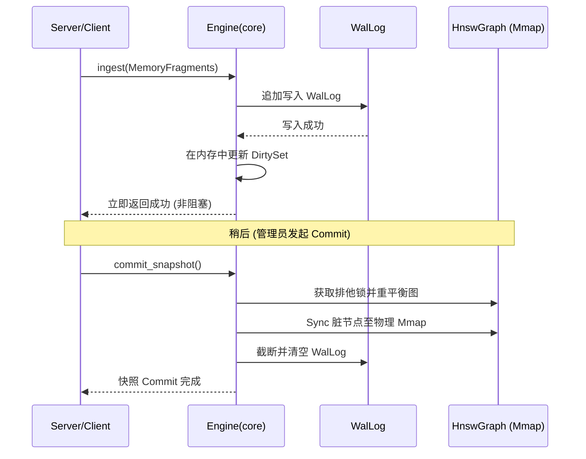

# Nexus-Base Core 核心引擎模块设计

本目录 (`nexus-core`) 包含 `Nexus-Base` 项目最底层的纯逻辑运算与数据管理实现。它**不感知**任何网络请求（如 gRPC）或命令行输入，是纯粹的计算密集型引擎库。

## 1. 职责与分工 (Responsibilities)
* **张量计算**: 执行针对特定架构 (AVX2/NEON) 优化的张量余弦相似度计算。
* **数据结构管理**: 维护和重平衡底层的 HNSW (分层导航小世界图)。
* **跨平台 I/O**: 基于 `memmap2` 和 `flock` 处理底层文件的读写、零拷贝加载及 WAL (预写日志) 的管理。
* **隔离性屏障**: 作为事务的实际执行层，负责执行 MVCC (多版本并发控制) 中的指针切换。

## 2. 契约接口 (Contract Interfaces)
对上层（如 `server`）主要暴露核心 Trait 与门面：

```rust
// 核心对外门面
pub trait TensorEngine: Send + Sync {
    /// 基于张量和锚点检索相关上下文 (无锁读)
    fn retrieve(&self, query_tensor: &[f32], anchors: &[String], top_k: usize) -> Result<Vec<MemoryFragment>, EngineError>;
    
    /// 将新的经验元组吸收入库 (写入 WAL)
    fn ingest(&self, fragments: Vec<MemoryFragment>) -> Result<(), EngineError>;
    
    /// 强制执行重平衡并将脏数据持久化至 .nxpack 物理磁盘快照
    fn commit_snapshot(&self) -> Result<(), EngineError>;
}
```

## 3. 关键数据结构 (Data Structures)
引擎内部围绕以下核心结构运转：
* `MemoryFragment`: 一条核心知识的最小载体。包含唯一 `id`、归属的文件/代码路径、纯文本的 `content_snippet`，以及对应的 `embedding` (如 `Vec<f32>` 768维)。
* `HnswGraph`: 基于共享引用或内存映射块 (Mmap block) 的导航图结构实体。
* `WalLog`: 内存中的追加列表与底层文件描述符的映射对象。

## 4. 主要工作流程 (Main Workflows)



1. **冷启动加载 (Bootstrap)**: `EngineBuilder` 根据传入的配置路径检查 `.nxpack` 存在与否。若存在，申请系统级文件锁，执行 `mmap` 并重建 `HnswGraph` 的内存入口指针。
2. **高速检索 (Search)**: 上层传入查询张量，核心引擎直接在 `HnswGraph` 中向下贪婪路由计算相似度，收集 top_k 个 `MemoryFragment` 后返回。
3. **异步摄入 (Ingestion)**: 将新节点数据追加到 `WalLog` 文件末尾，并挂入内存中的 `DirtySet` 链表。

## 5. 异常响应机制 (Error Handling)
`core` 层从不直接 `panic!`。所有的底层错误收敛于自定义枚举 `EngineError`，强制上层进行处理：
* `EngineError::CorruptedSnapshot`: 物理 `.nxpack` 文件校验和失败（需提示上层回滚）。
* `EngineError::DimensionMismatch`: 传入的张量维度与图初始化时的基准维度不符。
* `EngineError::LockAcquisitionFailed`: 试图打开文件却未获得 `flock`，说明可能存在未关闭的幽灵进程。
* `EngineError::IoFailure(std::io::Error)`: 物理磁盘读写或权限错误。
