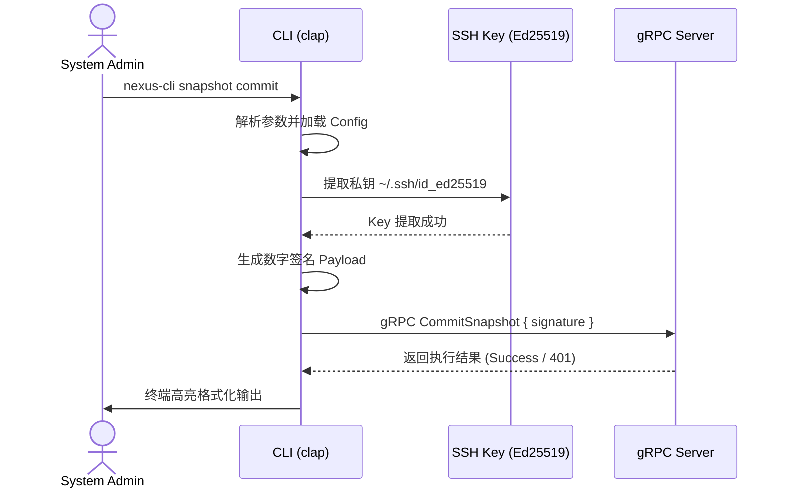

# Nexus-Base CLI 超级管理员终端模块

本目录 (`cli`) 是 `Nexus-Base` 项目的入口级应用，负责解析终端用户的命令并作为**超级管理员 (Super Admin)** 对核心张量知识库进行高级管控。

## 1. 职责与分工 (Responsibilities)
* **命令解析**: 通过 `clap` 框架解析终端的参数、标志与子命令。
* **生命周期管理**: 负责启动守护进程 (`nexus-cli start`) 载入网络服务器 (`server` 模块)。
* **离线与高危管控**: 处理必须通过超级管理员授权的物理层面管理操作，例如强制合并快照、导出打包，或清除所有记忆。
* **诊断与监控**: 抓取 `core` 和 `server` 吐出的结构化日志，并在终端格式化输出。

## 2. 契约接口 (Contract Interfaces)
CLI 层主要定义面向人类和操作系统的命令行契约规范：

```bash
# 启动常驻 Server (给各类 Agent 提供 IPC 通信接口)
$ nexus-cli start --config ~/.config/Nexus/config.toml

# 将 WAL 中的脏数据强制合并为最新的只读张量快照
$ nexus-cli snapshot commit --sign-key ~/.ssh/id_ed25519

# 回滚操作：丢弃当前内存和未提交日志，回到上个安全点
$ nexus-cli rollback --force
```

在代码层面，CLI 作为 Client 端，当服务器运行时，它通过 gRPC 协议访问 `server` 暴露的本地端口进行管控。当系统离线时，它直接链接 `nexus-core` 库，获得排他锁修改文件。

## 3. 关键数据结构 (Data Structures)
* `CliArgs`: 顶层的终端入参模型，描述所有支持的标志位。
* `AdminConfig`: 从本地系统级规范路径加载的配置集（包含数据挂载盘绝对路径、加密密钥位置等）。
* `CommandContext`: 运行时上下文结构，内部持有与本地服务器通讯的 `gRPC Client Channel`，或者离线直连时的 `Engine` 实例。

## 4. 主要工作流程 (Main Workflows)



1. **解析与初始化**: 解析进程级参数，尝试读取系统级路径下的 `.toml` 配置文件合并默认参数。
2. **鉴权加载**: 对于具有破坏性的指令（如 `commit`, `rollback`），CLI 将寻找本地机器上的特定 SSH 密钥或管理员凭证对请求进行数字签名 (Ed25519 签名)。
3. **命令路由**:
   * 若命令为 `start`，则实例化 `core::TensorEngine`，将其注入到 `server`，并阻塞启动后台守护进程。
   * 若命令为 `commit`，则构造并发送附带鉴权签名的 gRPC 载荷，等待服务器同步返回。
4. **输出格式化**: 收集底层返回的数据结构，基于终端支持的彩色打印工具（如 `colored`）向人类输出友好信息。

## 5. 异常响应机制 (Error Handling)
CLI 是程序的最外层边界。所有通过 gRPC 收到的状态码或直连 `core` 返回的 `EngineError`，必须在这里转化为人类可读的信息：
* **退出状态码 (Exit Code)**: 严格遵守 POSIX 标准，成功返回 `0`，配置错误返回 `2`，底层错误或网络异常返回 `1`。
* **人类可读输出**: 利用 `anyhow` 拦截内部异常，通过 `eprintln!` 输出附带红色警告及具体行号/原因的回溯堆栈 (Traceback)，并主动提供解决方案提示（例如：“提示：未找到私钥，请确保在系统级环境中运行”）。
