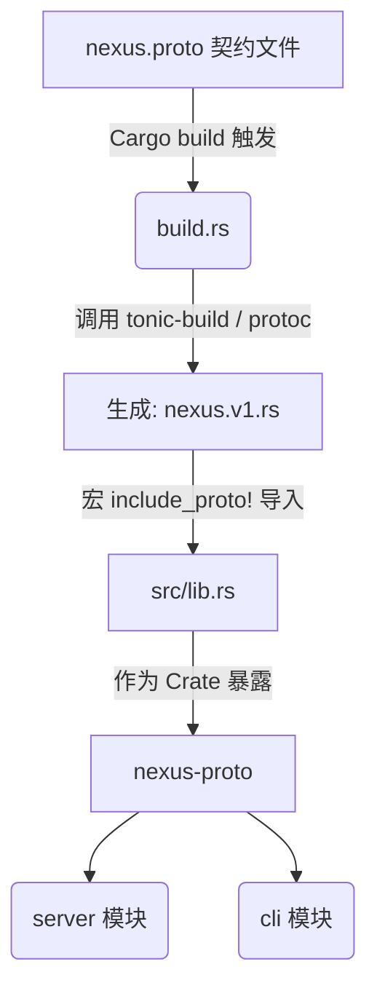

# Nexus-Base Proto 模块设计 (`nexus-proto`)

本目录 (`proto`) 是整个 `Nexus-Base` 项目的**唯一数据契约源 (Single Source of Truth)**。它本身不包含任何业务逻辑运算，其核心价值在于定义并生成供跨进程通信使用的结构体与服务骨架。

## 1. 职责与分工 (Responsibilities)
* **契约声明**: 通过 `nexus.proto` 文件定义底层的 `MemoryFragment` 数据结构以及 `NexusKnowledgeService` 的 RPC 方法。
* **代码生成**: 在 Cargo 构建时（`build.rs`），借助 `tonic-build` 自动调用 `protoc` 将协议缓冲文件编译为原生的 Rust Trait 与 Struct。
* **跨语言就绪**: 确保如果未来有基于 Python 或 Node.js 的 Agent 直接绕过 `cli` 进行调用，只需同一份 `.proto` 即可生成客户端。

## 2. 契约接口 (Contract Interfaces)
对上层暴露的主要是由 `tonic::include_proto!("nexus.v1");` 宏所展开的代码：
* `NexusKnowledgeServiceClient`: 供 `cli` (或 Agent) 实例化的异步 gRPC 客户端句柄。
* `NexusKnowledgeServiceServer`: 供 `server` 模块继承并绑定实际业务逻辑的服务端 Trait 骨架。

## 3. 关键数据结构 (Data Structures)
* 所有的 Request/Response 模型，例如 `RetrieveRequest`, `CommitResponse`。
* `MemoryFragment`：此结构体虽与 `core` 层中的领域模型同名，但它是为了网络传输序列化而生成的，支持 `#[derive(prost::Message)]` 等宏。

## 4. 主要工作流程 (Main Workflows)

1. **修改契约**: 架构师在 `nexus.proto` 中添加新的字段。
2. **触发构建**: 运行 `cargo build` 时，Cargo 优先执行本模块的 `build.rs`。
3. **宏展开导出**: `src/lib.rs` 中的宏将临时生成的 `nexus.v1.rs` 文件包含进来，最终暴露为一个纯 Rust 库供 `core`, `server`, `cli` 引用。

## 5. 异常响应机制 (Error Handling)
本模块为契约层，**不处理任何业务异常**。RPC 定义层面上，如果出现错误，将依赖外部的 `server` 层主动抛出标准的 gRPC `tonic::Status` 状态码（如 `UNAUTHENTICATED`, `INVALID_ARGUMENT`, `INTERNAL`），并在客户端层通过 `Result<Response, Status>` 被捕获。
