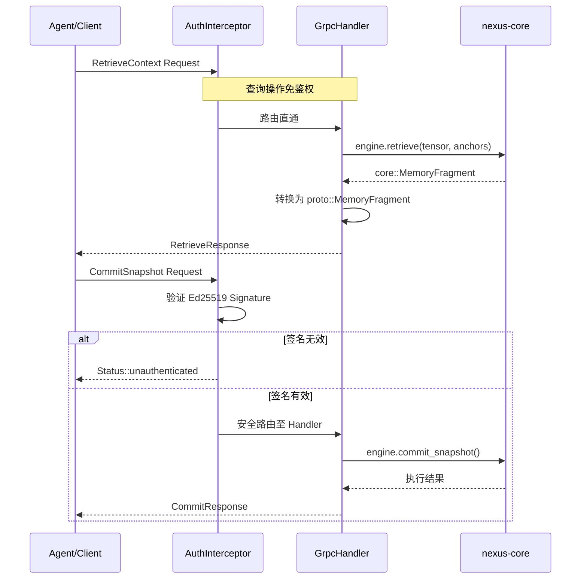

# Nexus-Base Server 模块设计 (`server`)

本目录 (`server`) 是 `Nexus-Base` 暴露给外界的**通信与安全网关**。它将冰冷的 `core` 张量引擎封装为一个能够处理高并发网络请求的现代守护进程。

## 1. 职责与分工 (Responsibilities)
* **网络承载**: 基于 `Tokio` 异步运行时和 `Tonic` (gRPC over HTTP/2)，监听 Unix Domain Socket 或 127.0.0.1 端口。
* **鉴权拦截**: 作为安全屏障，拦截所有流入的请求。对于高危操作（如 Commit, Rollback），必须验证 Ed25519 签名。
* **模型映射**: 负责将网络层传来的 Protobuf 结构（`nexus-proto`）映射并转换为底层的领域实体（`nexus-core`）。
* **日志隔离**: 为每一个请求生成唯一 Trace ID 并记录出入参日志，保护 `core` 不必关心可观测性。

## 2. 契约接口 (Contract Interfaces)
对上层暴露的主要是服务启动的挂载函数，内部则实现由 `proto` 生成的 Trait：

```rust
// 启动函数的假设形态
pub async fn start_server(config: ServerConfig, engine: Arc<dyn core::TensorEngine>) -> Result<(), ServerError> {
    // 绑定端口，注册 Interceptor，挂载 engine ...
}

// 内部实现契约
#[tonic::async_trait]
impl nexus_proto::NexusKnowledgeService for GrpcHandler {
    async fn retrieve_context(&self, req: Request<RetrieveRequest>) -> Result<Response<RetrieveResponse>, Status> {
        // ...
    }
}
```

## 3. 关键数据结构 (Data Structures)
* `GrpcHandler`: 实现了 gRPC Server Trait 的结构体，内部持有 `Arc<dyn TensorEngine>` 的引用。
* `AuthInterceptor`: 实现了 `tonic::service::Interceptor`，专门在请求到达 Handler 之前提取 HTTP/2 Header 进行签名校验。

## 4. 主要工作流程 (Main Workflows)



1. **服务启动**: `cli` 层调用 `start_server()`，初始化 `Tokio` 运行时，启动守护进程。
2. **请求路由**: Agent 发起 `RetrieveContext` 请求，数据到达网关后，解包提取出查询意图和 Anchors。
3. **调用核心**: Server 调用 `engine.retrieve()`（MVCC 无锁操作），由于是本地调用，返回速度极快。
4. **组装响应**: 将底层返回的领域层 `MemoryFragment` 转换为 Protobuf 定义的 `MemoryFragment`，封入 `RetrieveResponse` 中返回。

## 5. 异常响应机制 (Error Handling)
Server 扮演了底层异常到网络协议状态码的翻译官：
* 当拦截器发现签名校验失败时，直接抛出 `tonic::Status::unauthenticated("Invalid Admin Signature")`。
* 当调用 `engine.ingest()` 收到 `EngineError::LockAcquisitionFailed` 时，Server 会将其拦截，并映射为 `tonic::Status::resource_exhausted("Database is locked")`。
* 所有的异常转化都会在此层记录一行 `ERROR` 级别的 `tracing` 日志，以便诊断。
