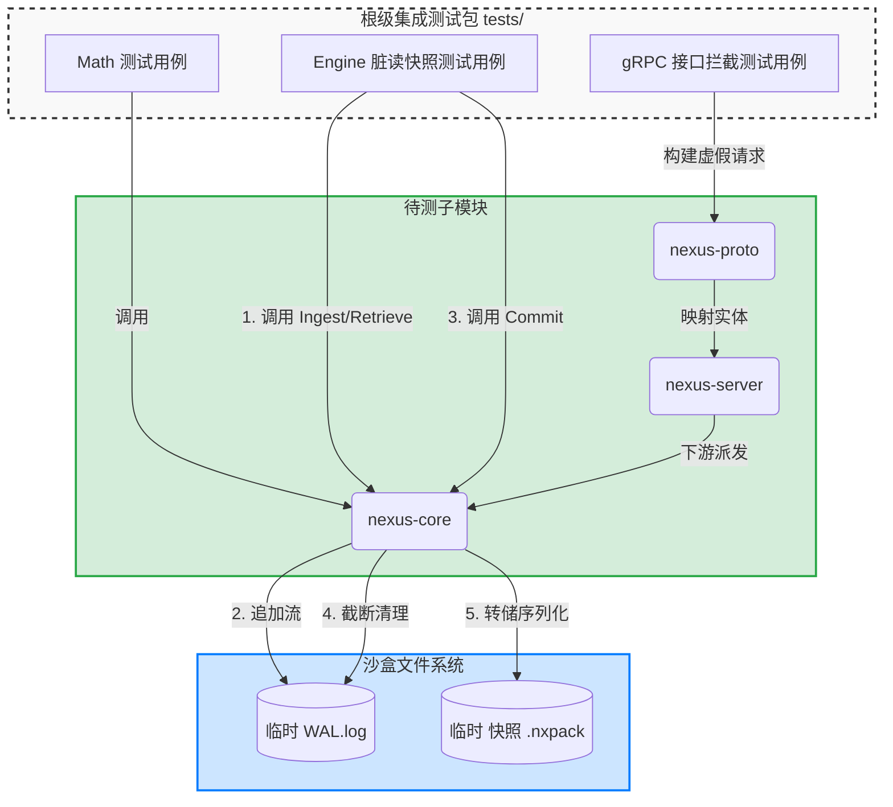

# 全局测试模块 (tests)

在 `Nexus-Base` 项目中，我们摒弃了将所有测试代码与业务逻辑混合存放在同一文件中的传统做法，转而采用建立一个根级别的宏观测试环境：**Workspace Member `tests`**。

这种隔离架构强制开发者必须从一个**外部消费者**的视角去调用公有的 API 接口，这不仅仅保证了代码树的绝对纯净，更是验证模块架构解耦的“黑盒试金石”。

## 业务流程图：黑盒集成测试架构

下面是通过 Mermaid 描述的测试包是如何与内部子模块进行隔离以及验证快照业务流的。



## 测试内容清单

目前，该全局模块囊括了对两个底层关键构件的防御性自动化验证：

1. **`core_integration.rs`**：
   - 数学组件的精度与正确性：`cosine_similarity` 的并发安全与计算精度。
   - 核心引擎 (`NexusEngine`) 生命周期闭环验证：验证从片段提取入库（追加 `wal_log`）、基于张量的在内存放检索 (`dirty_set`) 到最终持久化时（`commit_snapshot`）清空临时预写日志并固化快照的连贯流程。
2. **`server_integration.rs`**：
   - 端到端网络验证：测试 `nexus-server` 如何安全包装 `NexusEngine`，并在异步上下文中（`#[tokio::test]`）正确地执行由 `nexus-proto` 约定的 gRPC 报文解包及向下分发行为。

## 运行方式

通过在项目根目录执行：
```bash
cargo test -p tests
```
或直接由 VS Code `tasks.json` 一键发起全量验证。
